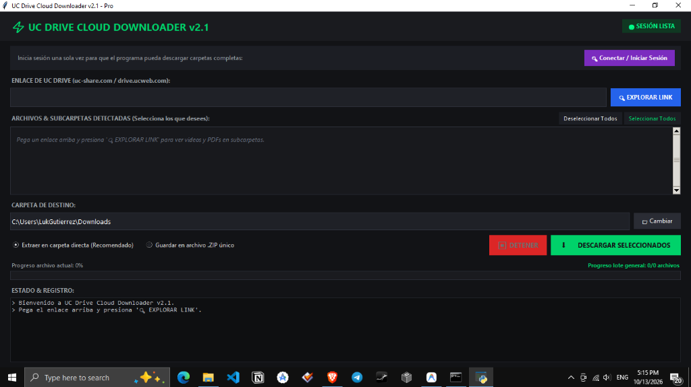

<div align="center">

# ⚡ UC Drive Cloud Downloader v2.1 Pro

### High-throughput bulk downloader & recursive folder exporter for UC Drive (`drive.ucweb.com` / `uc-share.com`).

**Bypass single-file web throttles, inspect deep subdirectories, and preserve full course folder hierarchies with native line speed.**

[](https://www.python.org/)
[](https://playwright.dev/)
[](LICENSE)
[](#requirements)

<br />



<br /><br />

[Problem & Engineering Solution](#the-problem--engineering-solution) · [Architecture & Internal Engine](#how-the-engine-works) · [Features](#key-features) · [Quick Start](#quick-start) · [Technical FAQ](#technical-faq)

</div>

---

## 📌 The Problem & Engineering Solution

### The Challenge with UC Drive
UC Drive (`drive.ucweb.com` / `uc-share.com`) is widely used for sharing massive educational material, full-length video courses, and technical archives. However, the standard web client presents severe operational bottlenecks:

1. **No Bulk Subfolder Download:** Shared folders containing nested directories (e.g., `Module 01/Videos`, `Resources/PDFs`) cannot be downloaded recursively in one click from the browser.
2. **Session Freezes & Captcha Injections:** Attempting manual batch selections in the web UI often triggers Cloudflare/Akamai anti-automation traps, session timeouts, or silent failures.
3. **Bandwidth Strangling in Browser Engine:** The browser's native blob-downloader chokes on files > 1 GB, leading to incomplete or corrupted transfers with no resume capability.

### What UC Drive Downloader Solves
**UC Drive Cloud Downloader** is a specialized desktop automation and stream-processing client built with Python, Playwright Chromium, and Tkinter:

- **Reverse-Engineered Share Tree API:** Hooks into UC's internal `sharepage/detail` and `token` REST endpoints to map the entire directory tree down to every nested leaf node without downloading unnecessary web assets.
- **Persistent Anti-Detect Chromium Profile:** Stores real authenticated cookies locally in `profile/`, completely bypassing bot-detection shields (`--disable-blink-features=AutomationControlled`).
- **Direct HTTP Stream Engine with 2 MB Buffers:** Downloads files directly to disk via raw HTTP range streams, bypassing browser-engine overhead and saturating your internet bandwidth.
- **Hierarchical Reassembly & ZIP Packaging:** Automatically recreates exact subfolder trees on your local filesystem or bundles everything into a structured `.zip` archive.

---

## 🛠️ How the Engine Works (Under the Hood)

```
[ UC Drive Shared Link ]
         │
         ▼
┌────────────────────────────────────────────────────────┐
│ 1. Persistent Context Interceptor (Playwright Chromium)│
│    - User-agent spoofing & automation flags stripped   │
│    - Reuses saved auth session (profile/)              │
└────────────────────────────────────────────────────────┘
         │
         ▼
┌────────────────────────────────────────────────────────┐
│ 2. Dynamic Reverse API Mapping (engine.py)             │
│    - Intercepts /sharepage/token and /sharepage/detail │
│    - Captures file IDs (fid), filenames, file sizes    │
│    - Recursively opens top-level directories           │
└────────────────────────────────────────────────────────┘
         │
         ▼
┌────────────────────────────────────────────────────────┐
│ 3. Direct Streaming Core (download_file_direct)        │
│    - Requests official CDN download tokens             │
│    - Streams with 2 MB high-throughput buffer chunks   │
│    - Reports real-time MB/s and bytes counter          │
└────────────────────────────────────────────────────────┘
         │
         ├──────────────────────────────┐
         ▼                              ▼
┌─────────────────────────┐   ┌──────────────────────────┐
│ Mode A: Direct Folder   │   │ Mode B: .ZIP Packaging   │
│ Preserves nested tree   │   │ Bundles all items into   │
│ directly on destination │   │ clean, portable archive  │
└─────────────────────────┘   └──────────────────────────┘
```

---

## ✨ Key Features

- **⚡ Full Line-Speed Saturation:** High-performance socket streaming with 2 MB chunk buffers delivering the maximum throughput your ISP provides.
- **📁 Deep Recursive Folder Inspection:** Automatically parses nested directories, listing all video lectures, slides, documents, and code assets.
- **🎯 Checkbox-Level Control:** Selective downloading—select individual files, entire modules, or all 40+ files at once.
- **💻 Real-Time Terminal Console:** Dark-themed live event console with microsecond timestamps and status badges.
- **📊 Precise Progress Metrics:** Per-file and batch progress bars, showing downloaded bytes (`450.2 MB / 1.3 GB`) and live transfer speed.
- **🔒 Zero Privacy Risk:** Runs 100% locally on your computer. Credentials and tokens remain exclusively in your local `profile/` folder; nothing is sent to external telemetry servers.

---

## 🚀 Quick Start

### Requirements
- **OS:** Windows 10 / 11 (64-bit)
- **Python:** Python 3.10 or higher
- **Dependencies:** `playwright`

### 1. Installation

Clone the repository and install dependencies:

```bash
git clone https://github.com/lukgutierrez/UC-Downloader.git
cd UC-Downloader
pip install -r requirements.txt
playwright install chromium
```

> **Note:** If you don't have a `requirements.txt`, simply run:
> ```bash
> pip install playwright
> playwright install chromium
> ```

### 2. Launching

Double-click **`Iniciar_UC_Downloader.bat`** or launch from terminal:

```bash
python app.py
```

### 3. Usage Flow

1. **One-Time Login:** Click **`🔑 Conectar / Iniciar Sesión`**. A clean browser window opens. Log into your UC Drive account and close the browser. Your session is now saved in `profile/`.
2. **Explore:** Paste any shared link (`drive.ucweb.com` or `uc-share.com`) into the input field and click **`🔍 EXPLORAR LINK`**.
3. **Select:** The file list will populate with all detected items, subfolders, and file sizes. Check the items you want.
4. **Download:** Select **"Extraer en carpeta directa"** or **"Guardar en archivo .ZIP"** and click **`⬇️ DESCARGAR SELECCIONADOS`**. Watch the progress bar and real-time speed in the live console!

---

## 📂 Project Structure

```
UC-Downloader/
├── app.py                     # Tkinter GUI (Dark theme v2.1 with live metrics)
├── engine.py                  # Core Playwright automation & HTTP stream engine
├── login.py                   # Standalone helper for persistent cookie authentication
├── Iniciar_UC_Downloader.bat  # 1-Click launcher script for Windows
├── assets/                    # Project screenshots and UI banners
│   └── preview.png            # Main interface capture
├── .gitignore                 # Excludes local profile/, logs, and temp_downloads/
└── README.md                  # Project documentation and technical overview
```

---

## ❓ Technical FAQ

<details>
<summary><b>Why not use simple HTTP requests or yt-dlp?</b></summary>
UC Drive protects shared link directories using dynamic JavaScript rendering, temporary authentication nonces, and browser-fingerprinting validations. A pure headless HTTP client gets blocked or served empty HTML payloads. UC-Downloader runs an orchestrated Chromium context that executes legitimate browser handshakes before routing raw binary chunks through Python sockets.
</details>

<details>
<summary><b>Is my UC Drive login secure?</b></summary>
Yes. The login is performed directly on official UC Drive web servers (`drive.ucweb.com`). Cookies are stored exclusively in your local machine's `profile/` directory and are explicitly excluded from Git version control via `.gitignore`.
</details>

<details>
<summary><b>Can it resume interrupted downloads?</b></summary>
Yes. The downloader writes to `.part` files in your temporary/destination directory and uses chunked writing to prevent corruption if a transfer is cancelled or closed.
</details>

---

## 📄 License

This project is licensed under the **MIT License** — feel free to use, modify, and distribute it for personal educational purposes.
